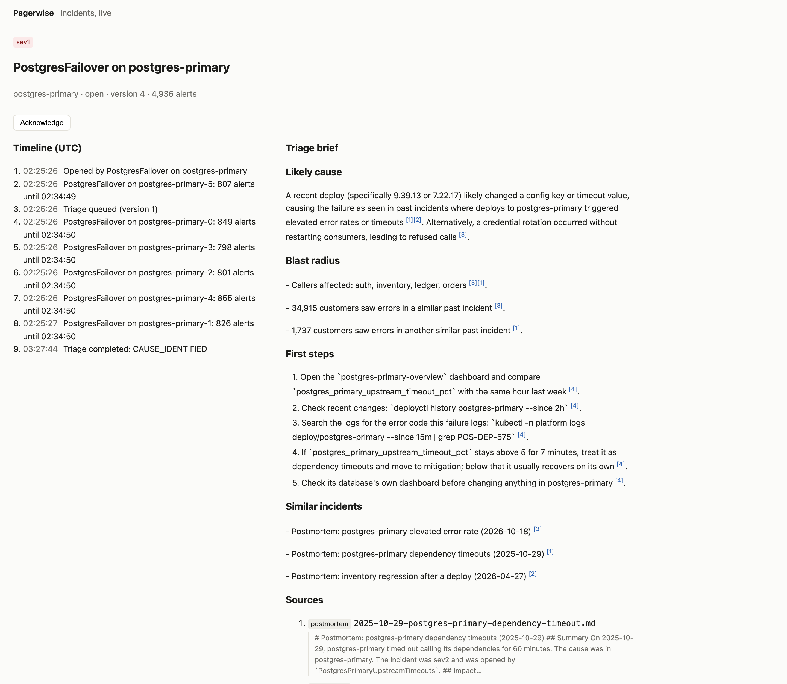
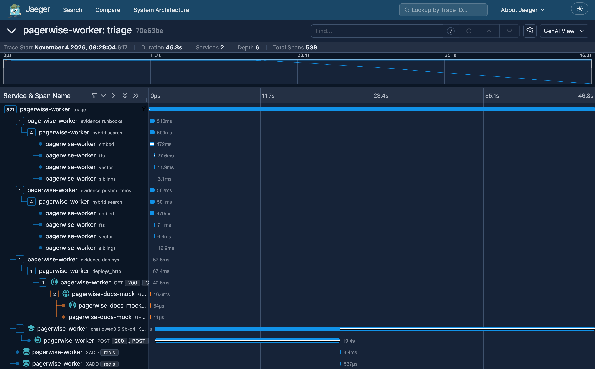
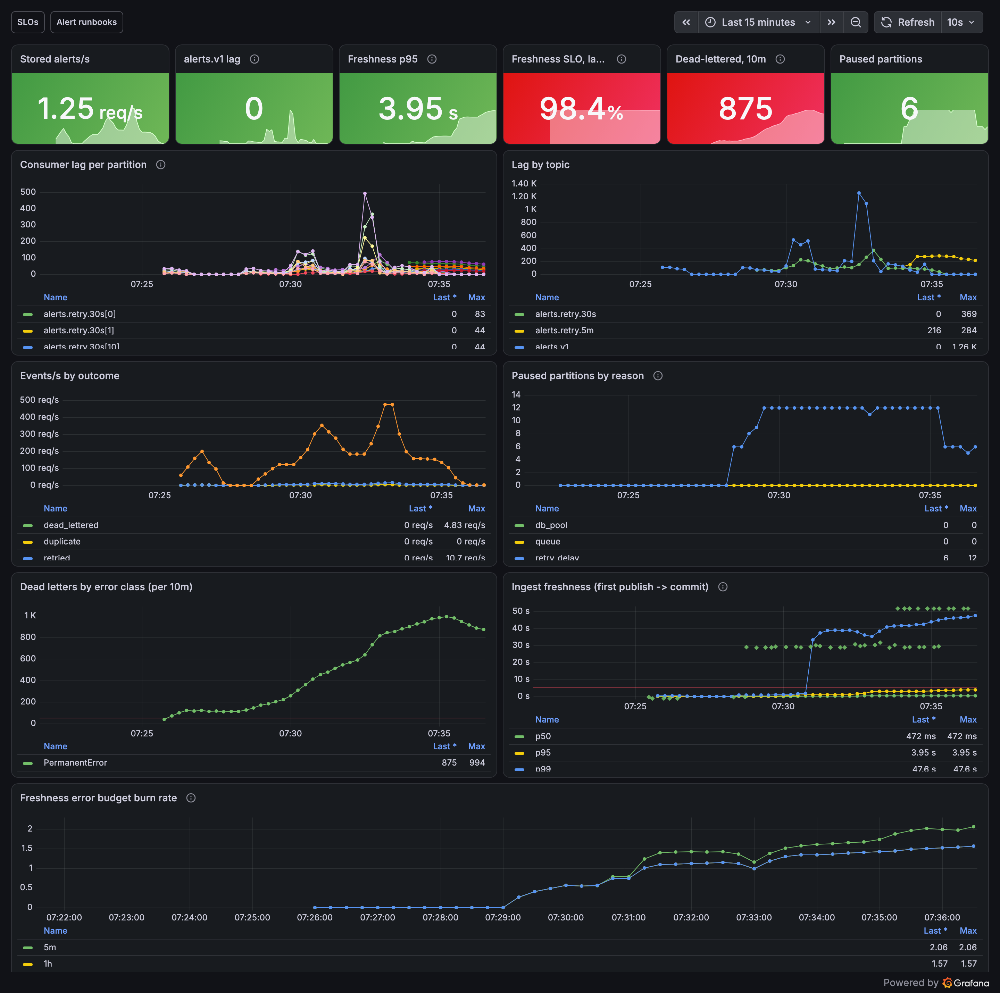
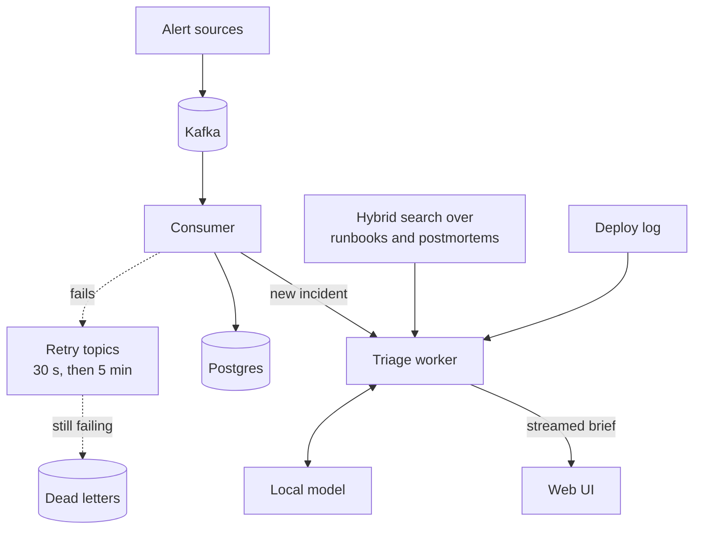

# Pagerwise

[](https://github.com/Abuubkar/pagerwise/actions/workflows/ci.yml)
[](https://github.com/Abuubkar/pagerwise/actions/workflows/release.yml)

**An on-call copilot that turns an alert storm into a short list of incidents, each with a cited triage brief.**

Pagerwise reads alerts from Kafka, groups thousands of them into a handful of incidents, and for every new incident
writes a brief: the likely cause, what else is affected, the first steps to try, and similar past incidents. Every
claim links to the runbook, postmortem or deploy it came from, and when nothing documents the failure the brief is
meant to say "insufficient evidence" rather than guess. Everything runs locally, including the model.

> **Status: complete.** All 8 planned slices are built, tested and merged. Known gaps are listed under
> [Limitations](#limitations).



*A Postgres failover during simulated traffic. Alerts from six instances became one incident, and the brief cites the
postmortems and runbook it drew on. Briefs stream in live as the model writes them.*

## Highlights

- **Holds up under load.** 2,000 alerts a second with a consumer killed mid-storm: nothing lost, every malformed
  event set aside for inspection, and the main topic caught up within a second of the storm ending.
- **Answers with sources.** Briefs cite numbered evidence, and code (not the model) checks every citation points at
  something that was actually supplied.
- **Degrades honestly.** If a source of evidence is down, the brief is still written from the rest and never
  mentions what's missing.
- **Measured, not eyeballed.** A generated golden set of 55 incidents scores retrieval, clustering and triage, and
  every pull request re-runs it with the recorded model calls.
- **Observable end to end.** One alert is one trace across every Kafka hop and retry; dashboards, SLOs and alerts
  with runbooks come with it.

## Results

Measured on an Apple M1 Pro laptop with 16 GB, with `qwen3.5:9b` running locally through Ollama.

| | Result | Target | Where |
|---|---|---|---|
| Finds the right evidence (recall@8) | **1.00** | ≥ 0.90 | [eval report](evals/REPORT.md#retrieval-ablation) |
| Search latency, p95 | **36 ms** | ≤ 250 ms | [eval report](evals/REPORT.md#retrieval-ablation) |
| Names the right root cause, first guess / top 3 | **0.80 / 0.84** | ≥ 0.60 / 0.80 | [eval report](evals/REPORT.md#triage) |
| Citations that support their sentence | **0.96** | ≥ 0.90 | [eval report](evals/REPORT.md#triage) |
| Briefs that stay silent about a missing source | **100%** | 100% | [eval report](evals/REPORT.md#gates) |
| Alerts grouped into the right incident (F1) | **0.85** | ≥ 0.84 | [eval report](evals/REPORT.md#clustering) |
| Alert storm: 360,000 alerts at 2,000/s, a consumer killed | **0 lost**, 3,526/3,526 malformed dead-lettered | 0 lost | [storm run](docs/runs/slice-03-done-when.txt) |

Where it falls short, reported as measured and never re-targeted:

| | Result | Target | Where |
|---|---|---|---|
| Says "insufficient evidence" when the cause isn't documented | 0.40 | ≥ 0.80 | [eval report](evals/REPORT.md#triage) |
| Briefs in the exact section format | 0.93 | ≥ 0.95 | [eval report](evals/REPORT.md#triage) |
| Sentences without a supporting citation | 14% | ≤ 8% | [eval report](evals/REPORT.md#triage) |
| Time to first token, p95 | 20.7 s | ≤ 20 s | [eval report](evals/REPORT.md#triage) |
| Alert stored within 5 s of publishing, p95 at 2,000/s | 6.3 s | ≤ 5 s | [storm run](docs/runs/slice-03-done-when.txt) |

Each slice's acceptance run is recorded in [docs/runs/](docs/runs/).

## Seeing inside it

One triage, as a trace: evidence from runbooks, postmortems and the deploy log in parallel, each search stage
timed, then the model call (time to first token 19 s, 524 tokens at 20 tokens/s).



An alert that failed once stays one trace across its retry, 30 seconds later
(`uv run python scripts/trace.py retry`):

```text
+  0.000s  alerts.v1 send             simulator      0.0 ms  publish
+  0.157s  alerts.v1 process          consumer     256.9 ms  attempt 1, error TransientError -> retried
+  0.397s  alerts.retry.30s send      consumer       0.1 ms  publish, x-attempt 1 (TransientError)
+ 30.537s  alerts.retry.30s process   consumer      15.0 ms  attempt 2, ok -> stored
          └ link -> alerts.retry.30s batch
             └ incident upsert    12.7 ms  inserted 1, incidents touched 1
```

The stream's dashboard during seven minutes of simulated traffic with 2% injected failures: lag absorbed, retries
draining, malformed alerts dead-lettered, and the freshness SLO visibly burning its error budget.



## Quick start

You need Docker and [Ollama](https://ollama.com). The model runs on the host, because Docker on macOS has no GPU
access. This runs the published images, no build needed:

```bash
git clone https://github.com/Abuubkar/pagerwise && cd pagerwise
ollama pull qwen3.5:9b-q4_K_M        # 6.6 GB, once
docker compose -f docker-compose.yml -f docker-compose.release.yml up -d --wait
```

The first start migrates the database and imports 186 runbooks and postmortems, which takes about two minutes. Then
send some alerts:

```bash
docker compose -f docker-compose.yml -f docker-compose.release.yml run --rm simulator --rate 200 --duration 60
```

| Open | What you'll see |
|---|---|
| http://localhost:3001 | Incidents appearing live; open one to watch its brief stream in |
| http://localhost:3000 | Grafana dashboards: stream health and triage quality |
| http://localhost:16686 | Jaeger: an alert's path through Kafka, or a triage step by step |

The images are signed by this repository's release workflow. To check before running:

```bash
cosign verify ghcr.io/abuubkar/pagerwise-api:main \
  --certificate-identity-regexp '^https://github.com/Abuubkar/pagerwise/\.github/workflows/release\.yml@refs/heads/main$' \
  --certificate-oidc-issuer https://token.actions.githubusercontent.com
```

## How it works



1. **Ingest.** The consumer reads alerts in batches and slows down instead of falling over: when its queue or
   database pool fills, it pauses reading until there's room. Offsets are committed only after the database, and
   writes are idempotent, so a crash replays work without duplicating it.
2. **Retry without blocking.** A message that fails moves to a 30-second retry topic, then a 5-minute one, then to
   dead letters, which can be replayed. A bad message never holds up the ones behind it.
3. **Cluster.** Alerts with the same fingerprint, service and time window join an incident; otherwise one with a
   similar summary on a neighbouring service. No model in this path, so it keeps up with the stream.
4. **Triage.** For each new incident, the worker gathers evidence from runbooks and postmortems (hybrid full-text and
   vector search) and from the deploy log, each with its own timeout. The local model writes the brief with a tag
   like `[C3]` after every claim, and code maps each tag back to its source.
5. **Check.** A parser enforces the brief's four sections and rejects any tag that wasn't supplied. Whether a brief
   may name a cause is decided by code too: it needs a matching runbook or postmortem, and a deploy alone is never
   enough.

The brief from the screenshot above, word for word (trimmed and line-wrapped). `Match:` names the evidence that describes
this failure; code decides from it whether the brief may name a cause.

```markdown
## Likely cause
Match: [C6][C7]
A recent deploy (specifically 9.39.13 or 7.22.17) likely changed a config key or timeout value, causing the
failure as seen in past incidents where deploys to postgres-primary triggered elevated error rates or timeouts
[C6][C7]. Alternatively, a credential rotation occurred without restarting consumers, leading to refused calls [C5].

## Blast radius
- Callers affected: auth, inventory, ledger, orders [C5][C6].
- 34,915 customers saw errors in a similar past incident [C5].

## First steps
1. Open the `postgres-primary-overview` dashboard and compare `postgres_primary_upstream_timeout_pct`
   with the same hour last week [C1].
2. Check recent changes: `deployctl history postgres-primary --since 2h` [C1].

## Similar incidents
- Postmortem: postgres-primary elevated error rate (2026-10-18) [C5]
- Postmortem: postgres-primary dependency timeouts (2025-10-29) [C6]
```

### The API

The UI is built on a REST API on `:8001`, written first as [contracts/openapi.yaml](contracts/openapi.yaml). Incidents,
newest first, filtered and paged with a cursor:

```bash
curl 'localhost:8001/v1/incidents?severity=sev1&limit=1'
```

```json
{
  "items": [
    {
      "id": "01a1a4a4-de88-7075-9727-b6aa72bad84c",
      "title": "OrdersCheckoutErrors on orders",
      "service": "orders",
      "severity": "sev1",
      "status": "open",
      "summary": "checkout errors 40% on orders-3",
      "opened_at": "2026-11-04T03:40:29.743251Z",
      "version": 1
    }
  ],
  "next_cursor": "eyJ0IjoiMjAyNi0xMS0wNFQwMzo0MDoyOS43NDMy..."
}
```

An incident's brief, as server-sent events: live while the model writes it, replayed once it's stored. The text
comes first, then each section's resolved citations, and a final `done` with the whole parsed brief:

```bash
curl -N localhost:8001/v1/incidents/01a19d30-e5e3-7471-b1ea-1595406e68fb/triage/stream
```

```text
event: token
data: {"text":"## Likely cause\nThe incident occurred shortly after the deployment of redis-cache version 6.38.7 [C8], ..."}

event: citation
data: {"tag":"C8","source_type":"deploy","source_id":"dep-0323","section":"likely_cause","chunk_excerpt":"Deploy dep-0323: redis-cache version 6.38.7 deployed at 2026-10-25T10:48:00Z ..."}

event: section_complete
data: {"section":"likely_cause"}

event: done
data: {"verdict":"CAUSE_IDENTIFIED","sections":{...},"model":"qwen3.5:9b-q4_K_M","degraded_sources":[], ...}
```

The same incidents are on GraphQL at `/graphql` (Relay connections, plus a subscription for live updates), and
`POST /v1/admin/dlq/replay` republishes dead letters by offset range or key. Errors are RFC 9457 problem+json with
a stable `code`, each documented in [docs/problems.md](docs/problems.md).

## Design decisions

| Decision | Why | ADR |
|---|---|---|
| A local model (`qwen3.5:9b`) through Ollama | Free, private, and fast enough on a laptop | [0001](docs/adr/0001-local-llm-qwen3.5-9b-via-ollama.md) |
| Citations as `[Cn]` tags, checked by code | Local models have no citation feature; a model never grades itself | [0003](docs/adr/0003-chunking-and-citation-contract.md) |
| The OpenAPI file is the contract | Written first; CI fails if code would break a generated client | [0004](docs/adr/0004-spec-first-contracts-sse-triage-on-stream-open.md) |
| Retry topics instead of in-place retries | A poison message never blocks a partition | [0005](docs/adr/0005-kafka-ingestion-retry-topics-backpressure.md) |
| Hybrid search, reranker off | Measured: the reranker changed no metric, so it's off until a harder eval shows a gain | [0006](docs/adr/0006-corpus-import-and-hybrid-retrieval.md), [0009](docs/adr/0009-golden-set-eval-v2-embeddings-siblings.md) |
| Clustering in plain code | Deterministic, testable, and fast enough for the stream | [0007](docs/adr/0007-alert-clustering-redis-and-partitioned-alerts.md) |
| Alerts table partitioned by day, migrated online | Queries for recent alerts read one day, not the whole history; the switch ran while alerts kept flowing | [0007](docs/adr/0007-alert-clustering-redis-and-partitioned-alerts.md) |
| Triage in a background worker | Requests never wait on the model, and every viewer watches the same brief stream in | [0008](docs/adr/0008-triage-worker-evidence-sources-live-ui.md) |
| Citation quality checked deterministically | No local judge model agreed with hand labels well enough (κ < 0.70) | [0010](docs/adr/0010-triage-eval-deterministic-citations-cause-gate.md) |
| Signed multi-arch images | Scanned before they're signed; only signed images verify | [0011](docs/adr/0011-ci-cd-github-actions-images.md) |
| OpenTelemetry across Kafka hops | One alert is one trace, retries included; no prompt text ever leaves the process | [0012](docs/adr/0012-opentelemetry-tracing-metrics-slos.md) |

## Development

You need Docker, [uv](https://docs.astral.sh/uv/), [pnpm](https://pnpm.io) and Ollama.

```bash
docker compose up -d --wait               # Postgres, Redpanda, Redis and the observability stack
uv run alembic upgrade head && make topics
uv run python scripts/seed.py graph       # the simulated 12-service system
uv run python -m pagerwise_docs_mock      # the docs API the indexer imports from (:8002)
uv run python -m pagerwise_indexer        # import runbooks and postmortems
uv run python -m pagerwise_consumer       # in its own terminal; likewise the next two
uv run python -m pagerwise_api            # API on :8001
uv run python -m pagerwise_api.worker     # triage worker
cd apps/web && pnpm install && pnpm dev   # UI on :3001
```

```bash
make test         # unit tests, offline
make test-int     # against real Postgres, Redpanda and Redis (needs Docker)
make eval         # retrieval, clustering and triage on the golden set, model calls replayed
make storm        # 2,000 alerts/s for 3 minutes with a consumer killed (~10 minutes)
make lint         # what CI's lint job runs
```

Every command is in [CLAUDE.md](CLAUDE.md#run-it).

## Roadmap

Built in thin slices, each one end to end. The plan is in [02-pagerwise.md](02-pagerwise.md).

| Slice | Delivers | Status |
|---|---|---|
| 1 | Walking skeleton: ask a question, get a cited answer | Done |
| 2 | Spec-first REST API, streamed triage, typed client, GraphQL | Done |
| 3 | Kafka ingestion with backpressure, retry topics and dead letters | Done |
| 4 | Runbook and postmortem import, hybrid search, clustering, partitioned alerts | Done |
| 5 | Triage worker, three evidence sources with degradation, live UI | Done |
| 6 | Golden set, retrieval, clustering and triage evals, embedding migration | Done |
| 7 | CI on every pull request; signed multi-arch images | Done |
| 8 | OpenTelemetry across Kafka hops, metrics, SLOs, alerts and dashboards | Done |

## Limitations

- **Abstention is weak.** On incidents whose cause isn't documented, the model still names one 60% of the time.
- **Format slips more on live traffic.** Of the 4 briefs generated for the screenshots, 2 broke the section format
  and were stored as `format_invalid`, against 7% in the eval.
- **Full-text search finds nothing** for triage queries, so retrieval leans on vectors alone.
- **No logins, no paging.** Alerts show in Prometheus and Grafana; there's no Alertmanager route.
- **Not deployed.** The signed images and the release compose file are ready; nothing runs them on a server.

What went wrong along the way, and why each fix was chosen, is in [docs/challenges.md](docs/challenges.md).

## Repository layout

```text
apps/api/          REST, GraphQL and SSE API; triage worker; retrieval; migrations
apps/consumer/     Kafka consumer: backpressure, retries, clustering
apps/indexer/      imports runbooks and postmortems, chunked and embedded
apps/simulator/    alert generator for the simulated 12-service system
apps/docs_mock/    a paginated docs API and deploy log, with injectable failures
apps/web/          Next.js incident list and live triage view
packages/          Kafka helpers, telemetry, generated clients
contracts/         OpenAPI, GraphQL and Kafka (AsyncAPI) contracts
evals/             golden set, scoring, recorded model calls, reports
observability/     collector, Prometheus rules, Grafana dashboards
```

## Documentation

| | |
|---|---|
| [docs/adr/](docs/adr/) | 12 decisions: what was chosen, why, and the alternatives |
| [docs/challenges.md](docs/challenges.md) | what went wrong in each slice, and what we did about it |
| [docs/slo.md](docs/slo.md), [docs/alerts.md](docs/alerts.md) | the service level objectives, and what to do when each alert fires |
| [docs/architecture.md](docs/architecture.md) | where the design was heading from the start |
| [HOW_WE_BUILD.md](HOW_WE_BUILD.md) | the working rules this was built under |
